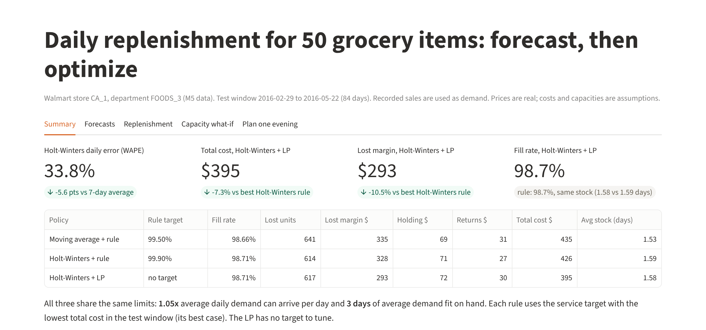
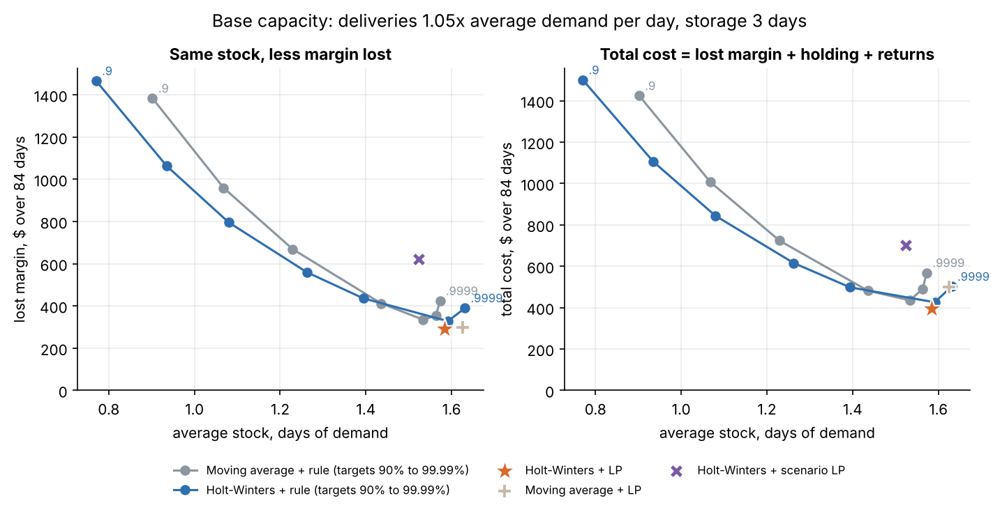
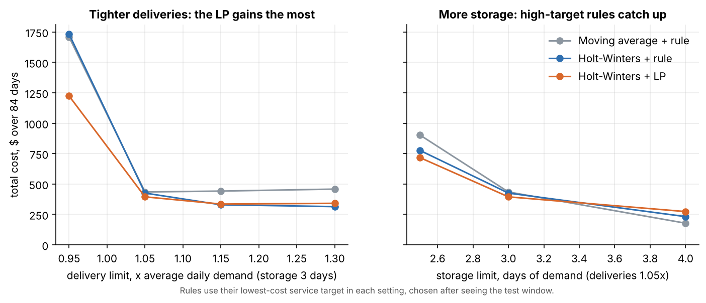
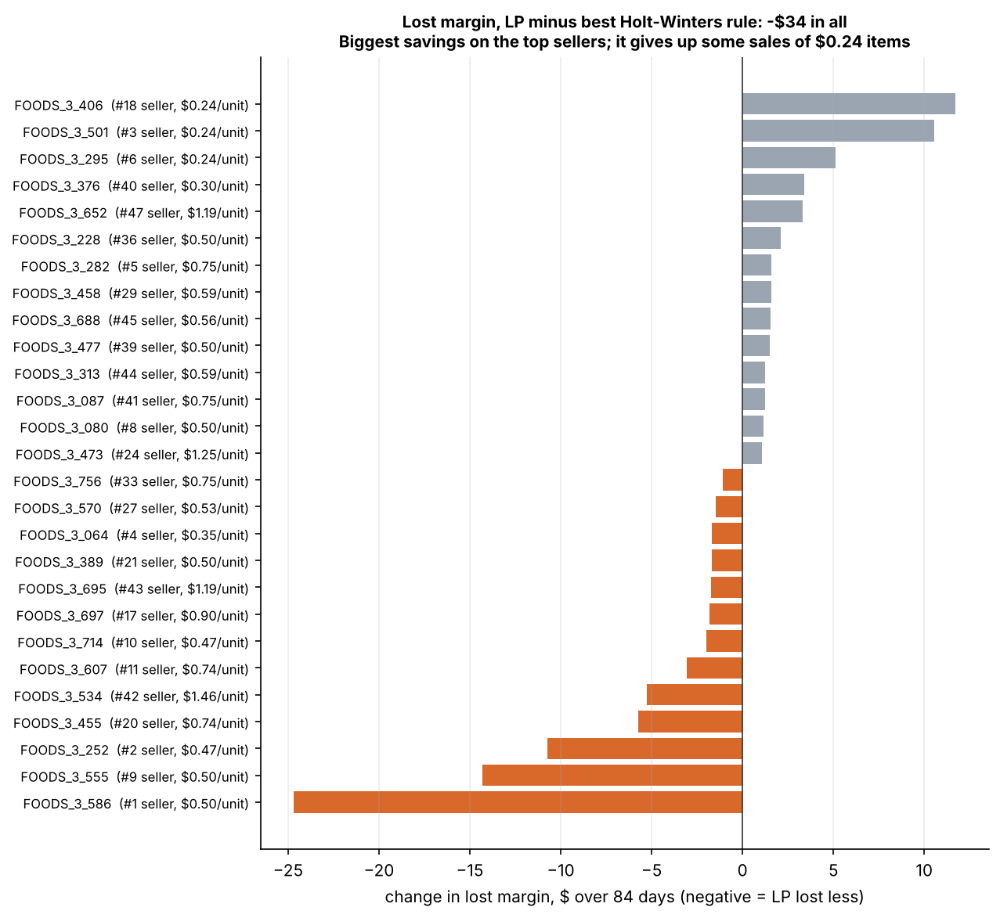

# How much should a store order each night when deliveries and space are limited?

English | [中文](README.zh.md)

One Walmart store, 50 fast-selling grocery items, two years of real daily sales ([M5 data](#sources)). Every evening the store orders stock that arrives two days later. Only so many units can be delivered per day, and only so many fit in the store. This repo forecasts daily demand with Holt-Winters, decides the orders with a linear program (LP), and replays both against the last 84 days of real sales next to simpler methods.



## What I found

- **Holt-Winters is the most accurate of six forecasts.** Daily error (WAPE) is 33.8%, against 39.4% for a 7-day moving average (14% lower) and 36.4% for the best simple method, a same-weekday average. Saturday and Sunday sales run about 30% above average. Holt-Winters learns that weekly pattern and updates its level every day, while the simple methods either ignore the pattern or copy last weeks' noise. It also ranks first in two other stores.
- **A better forecast alone saves little when capacity binds.** With the same order-up-to rule, switching from the moving average to Holt-Winters cuts total cost from $435 to $426 (2%). About two thirds of lost sales fall on Sunday through Tuesday: weekend demand drains the shelves and the truck runs full for the next two days while stock catches up. A better forecast does not add truck space.
- **The LP helps most when capacity is tight.** At the base limits (deliveries 5% above average daily demand, 3 days of storage), Holt-Winters + LP loses 10.5% less margin and costs 7.3% less than the best Holt-Winters rule, at the same fill rate (98.7%) and the same stock (1.6 days). When deliveries are cut to 95% of average demand, it costs 29% less ($1,224 vs $1,733). It loses about as many units as the rule (617 vs 614) but chooses which ones: when the truck or the space runs short, the rule cuts every item by the same share, while the LP keeps the biggest sellers in stock and lets the $0.24-margin items run short (figure 5).
- **It does not always win.** With looser deliveries (1.15x and 1.30x) it still loses a little less margin but sends back more units that do not fit, so it costs 2% to 9% more than the best rule. With 4 days of storage, a rule with a 99.99% target is cheapest: under these costs holding stock is almost free, and the LP's buffers assume normally distributed errors, which understates how often sales spike.
- **The LP needs the better forecast.** Fed with the moving-average forecast, the same LP cost more than the plain moving-average rule in 5 of 6 capacity settings, mostly from units that did not fit and went back on the truck.
- **A scenario version of the LP did worse ($700 vs $395).** It planned against 20 demand paths sampled from past forecast errors. A lost sale costs about 600 times more than holding a unit for a day, so the right stock covers rare spikes, and 20 samples rarely include them.

Base limits, 50 items, 84 test days (February 29 to May 22, 2016):

| Policy | Service target | Fill rate | Lost margin | Holding | Returns | Total cost | Average stock |
|---|---:|---:|---:|---:|---:|---:|---:|
| 7-day moving average + order-up-to rule | 99.5% | 98.66% | $335 | $69 | $31 | $435 | 1.53 days |
| Holt-Winters + order-up-to rule | 99.9% | 98.71% | $328 | $71 | $27 | $426 | 1.59 days |
| **Holt-Winters + LP** | none | 98.71% | **$293** | $72 | $30 | **$395** | 1.58 days |

Each rule uses the target (out of 90% to 99.99%) with the lowest total cost, picked after seeing the test window. That is the rules' best case; the LP has nothing to tune.

Total cost under other limits (same 84 days):

| Deliveries per day | Storage | Moving average + rule | Holt-Winters + rule | Holt-Winters + LP | LP vs Holt-Winters rule |
|---:|---:|---:|---:|---:|---:|
| 0.95x | 3 days | $1,708 | $1,733 | **$1,224** | -29% |
| 1.05x | 2.5 days | $904 | $777 | **$718** | -8% |
| 1.05x | 3 days (base) | $435 | $426 | **$395** | -7% |
| 1.05x | 4 days | **$178** | $232 | $274 | +18% |
| 1.15x | 3 days | $442 | **$329** | $335 | +2% |
| 1.30x | 3 days | $458 | **$314** | $342 | +9% |

Two more stores, base limits: in TX_1 (40 items) the LP costs $205 against $209 for the best Holt-Winters rule (-2%) and $225 for the moving-average rule; in WI_1 (37 items), $153 against $161 (-5%) and $187.

So: when deliveries or space are tight, which is when a store loses sales, plan all items together with an LP on a good forecast. When there is room to spare, a simple rule on the same forecast does as well.







## How it works

1. **Data.** M5 store CA_1, department FOODS_3. I kept the 50 items with the most sales in the last year among items with no more than 10% zero-sales days in the last two years (many zeros usually mean the shelf was empty, so sales do not show demand). 730 days, May 24, 2014 to May 22, 2016. The store is closed on Christmas; those two days are filled with the average of the same weekday a week before and after. Prices are each item's median shelf price over the 13 weeks before the test window ($0.80 to $4.88).
2. **Forecasts.** Six models, each refit every evening on the last 364 days and forecasting 7 days ahead: naive, seasonal naive, 7-day moving average, same-weekday average over 4 weeks, simple exponential smoothing, and Holt-Winters (additive damped trend, additive weekly season, statsmodels). Accuracy is scored on the 78 evenings whose next 7 days fall in the test window.
3. **Forecast error.** For each item and evening, the standard deviation of the last 56 errors of the 2-day forecast total (the stock an order has to cover).
4. **Order-up-to rule (baseline).** Order up to the 2-day forecast + z × error. If orders exceed the delivery limit or the space left, all of them are cut by the same share.
5. **LP (PuLP with the HiGHS solver).** Each evening it plans six evenings of orders for all 50 items over the next 7 days:
   - stock tonight = stock last night + delivery - units sent back - forecast demand + demand not met
   - units delivered per day ≤ delivery limit; stock after delivery ≤ storage limit
   - cost = lost margin on demand not met + lost margin on the shortage expected from forecast error + holding + $0.10 per unit sent back

   The expected shortage with a buffer of b units is σ·G(b/σ), where G is the standard normal loss function. G is convex, so it fits in an LP as 11 straight pieces from 0 to 3.5σ, and the first units of buffer are worth the most. This replaces a fixed service target: each item's buffer comes from its margin, its forecast error and the shared limits. Only tonight's orders are placed; the LP is solved again the next evening (rolling horizon). One solve takes about 0.08 seconds.
6. **Simulation.** Each policy runs on the real daily sales for 98 days (14 warm-up, 84 scored), from the same starting stock. Morning: deliveries arrive, and units that do not fit go back. Day: sales are the smaller of stock and demand; the rest is lost. Evening: the policy orders.

## Assumptions

All inputs are in [`src/assumptions.py`](src/assumptions.py).

| Input | Value | Note |
|---|---|---|
| Lead time | 2 days | Assumption: ordered after close on day t, on the shelf on day t+2 |
| Gross margin | 30% of shelf price | Assumption, grocery-like. A lost sale costs the margin ($0.24 to $1.46 per unit) |
| Holding cost | 25% of unit cost per year | Assumption (capital, space, handling). About $0.001 per unit per day |
| Delivery limit | 1.05 × average daily demand (583 units) | Assumption. Average of the 28 days before the test window |
| Storage limit | 3 days of average demand (1,667 units) | Assumption. One shared pool for the 50 items |
| Units sent back | $0.10 each | Assumption: delivered units that do not fit go back on the truck |
| Error window | last 56 days | Used for both the rules and the LP |

## Limitations

- Recorded sales are not demand. When an item was out of stock in the real store, sales understate demand. Items with many zero days are left out, but some of this remains.
- Costs and limits are assumptions, and delivery and storage are shared pools, not truck cubes or shelf space per item.
- Under these costs a lost sale is worth about 600 days of holding, so policies that keep more stock look good. Perishable items would change that.
- The rules' service targets are picked with hindsight. The LP is not tuned, but its buffers assume normally distributed errors.
- One department, one 12-week window, and two extra stores at the base limits only. Units are not rounded.

## Dashboard

```bash
streamlit run app/streamlit_app.py
```

Five tabs: summary, forecasts per item, stock and deliveries per policy, capacity what-ifs, and re-solving the LP for any evening with your own delivery and storage limits.

## Run it

```bash
pip install -r requirements.txt
python src/prepare_data.py      # downloads M5 (about 50 MB), writes data/processed/
python src/run_all.py --refit   # forecasts (about 3 minutes on 4 cores) + all policy runs (about 2 minutes)
python src/robustness.py        # the same on stores TX_1 and WI_1
python src/make_figures.py
pytest
```

`data/processed/` and `results/` are in the repo, so the tests, the figures and the dashboard run without the download. CI runs the tests and re-runs the policies at the base limits on every push.

## Sources

- M5 Forecasting competition data (Walmart; University of Nicosia), downloaded from [Nixtla's copy](https://github.com/Nixtla/m5-forecasts). Makridakis, Spiliotis and Assimakopoulos (2022), "M5 accuracy competition: Results, findings, and conclusions," *International Journal of Forecasting* 38(4).
- [statsmodels ExponentialSmoothing](https://www.statsmodels.org/stable/generated/statsmodels.tsa.holtwinters.ExponentialSmoothing.html), [PuLP](https://coin-or.github.io/pulp/), [HiGHS](https://highs.dev/).

Built with help from AI coding tools.
