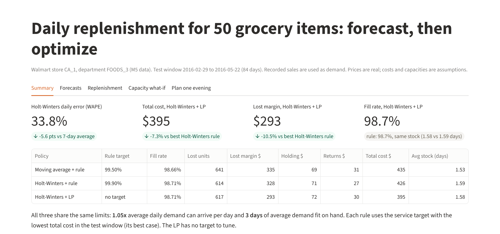
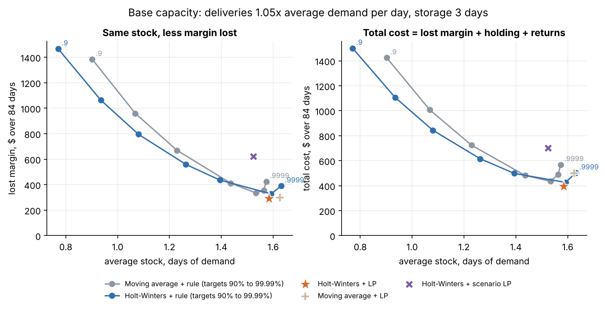
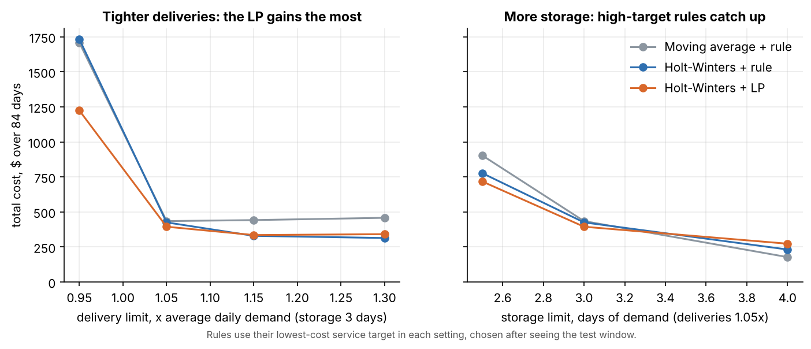
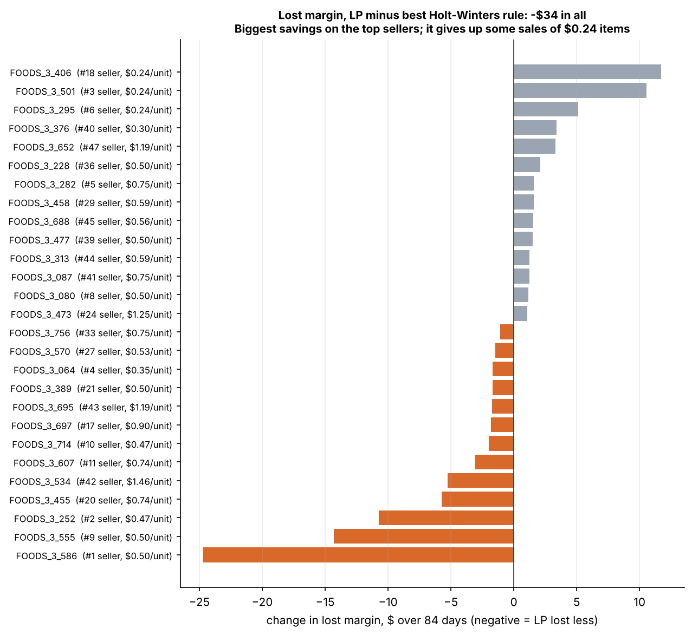

# 送货量和库存空间都有限时，门店每晚该订多少货？

[English](README.md) | 中文

一家 Walmart 门店，50 个畅销食品，两年真实日销量（[M5 数据](#数据和参考)）。门店每晚下单，货两天后到。每天能送到的件数有上限，店里能放下的件数也有上限。这个项目用 Holt-Winters 预测每日需求，用线性规划（LP）决定订货量，再拿最后 84 天的真实销量，把它和更简单的做法放在一起回放比较。



## 结论

- **六种预测里 Holt-Winters 最准。** 日误差（WAPE）33.8%，7 天移动平均是 39.4%（误差低 14%），最好的简单方法（同星期几的 4 周平均）是 36.4%。周六、周日销量比平均高约 30%，Holt-Winters 能学到这个周规律，并且每天更新水平；简单方法要么忽略周规律，要么把过去几周的噪音一起照搬。在另外两家门店也排第一。
- **容量吃紧时，光换更准的预测省不了多少。** 用同一个补货规则（order-up-to），把移动平均换成 Holt-Winters，总成本从 $435 降到 $426（2%）。大约三分之二的缺货发生在周日到周二：周末把货架卖空，之后两天卡车都是满载在补货。预测再准也变不出更多卡车空间。
- **容量越紧，LP 帮助越大。** 在基准容量下（每天送货量比平均日需求高 5%，库存空间 3 天），Holt-Winters + LP 比调到最优的 Holt-Winters 规则少损失 10.5% 毛利、总成本低 7.3%，填充率相同（98.7%），平均库存也相同（1.6 天）。送货量降到平均需求的 95% 时，总成本低 29%（$1,224 对 $1,733）。两者缺货件数差不多（617 对 614），区别在于缺哪些：卡车或空间不够时，规则把所有商品按同一比例砍；LP 优先保住最畅销的商品，让毛利只有 $0.24 的商品多缺一点（图 5）。
- **LP 不是总赢。** 送货比较宽松时（1.15 倍、1.30 倍），LP 仍然少损失一点毛利，但放不下被退回的货更多，总成本比最优规则高 2% 到 9%。库存空间有 4 天时，服务水平设到 99.99% 的规则最便宜：在这组成本假设下囤货几乎不花钱，而 LP 的安全库存假设误差服从正态分布，低估了销量突然冲高的频率。
- **LP 需要好的预测。** 同一个 LP 如果用移动平均预测，在 6 种容量设置中有 5 种比直接用移动平均规则还贵，主要是放不下、被退回的货太多。
- **情景版 LP 效果更差（$700 对 $395）。** 它用从历史误差里抽的 20 条需求路径来做计划。一次缺货的损失约等于一件货放 600 天的持有成本，所以合理的库存要能覆盖少见的销量高峰，而 20 条样本很少包含这种高峰。

基准容量，50 个商品，84 个测试日（2016 年 2 月 29 日到 5 月 22 日）：

| 策略 | 服务水平目标 | 填充率 | 损失毛利 | 持有成本 | 退货成本 | 总成本 | 平均库存 |
|---|---:|---:|---:|---:|---:|---:|---:|
| 7 天移动平均 + 补货规则 | 99.5% | 98.66% | $335 | $69 | $31 | $435 | 1.53 天 |
| Holt-Winters + 补货规则 | 99.9% | 98.71% | $328 | $71 | $27 | $426 | 1.59 天 |
| **Holt-Winters + LP** | 无 | 98.71% | **$293** | $72 | $30 | **$395** | 1.58 天 |

每个规则都用 90% 到 99.99% 中总成本最低的目标，而且是看过测试期结果后挑的，相当于给规则最有利的条件；LP 没有需要调的参数。

其他容量下的总成本（同样 84 天）：

| 每天送货上限 | 库存空间 | 移动平均 + 规则 | Holt-Winters + 规则 | Holt-Winters + LP | LP 对比 Holt-Winters 规则 |
|---:|---:|---:|---:|---:|---:|
| 0.95 倍 | 3 天 | $1,708 | $1,733 | **$1,224** | -29% |
| 1.05 倍 | 2.5 天 | $904 | $777 | **$718** | -8% |
| 1.05 倍 | 3 天（基准） | $435 | $426 | **$395** | -7% |
| 1.05 倍 | 4 天 | **$178** | $232 | $274 | +18% |
| 1.15 倍 | 3 天 | $442 | **$329** | $335 | +2% |
| 1.30 倍 | 3 天 | $458 | **$314** | $342 | +9% |

另外两家门店（基准容量）：TX_1（40 个商品）LP $205，最优 Holt-Winters 规则 $209（-2%），移动平均规则 $225；WI_1（37 个商品）分别是 $153、$161（-5%）、$187。

所以：送货或空间吃紧时（也正是门店最容易丢销量的时候），应该在好的预测上用 LP 统一规划所有商品；容量有富余时，同样的预测加简单规则就够了。







## 做法

1. **数据。** M5 门店 CA_1、FOODS_3 部门。在过去两年零销量天数不超过 10% 的商品里（零销量多通常说明货架空了，销量反映不了需求），取过去一年销量最高的 50 个。共 730 天，2014 年 5 月 24 日到 2016 年 5 月 22 日。圣诞节门店关门，这两天用前后一周同星期几的平均值填补。价格是每个商品在测试期前 13 周的货架价中位数（$0.80 到 $4.88）。
2. **预测。** 6 个模型，每晚都用最近 364 天重新拟合，预测未来 7 天：naive、季节 naive、7 天移动平均、同星期几 4 周平均、简单指数平滑、Holt-Winters（加法阻尼趋势、加法周季节，statsmodels）。准确率按未来 7 天都落在测试期内的 78 个晚上计算。
3. **预测误差。** 每个商品每晚，取最近 56 次"2 天预测总量"误差的标准差（一次订货要覆盖的就是这 2 天）。
4. **补货规则（基准）。** 订到"2 天预测 + z × 误差"。如果订货超过送货上限或剩余空间，所有商品按同一比例砍。
5. **LP（PuLP + HiGHS 求解器）。** 每晚为 50 个商品规划接下来 6 个晚上的订货，覆盖未来 7 天：
   - 今晚库存 = 昨晚库存 + 到货 - 退回 - 预测需求 + 未满足需求
   - 每天到货 ≤ 送货上限；到货后库存 ≤ 空间上限
   - 成本 = 未满足需求的毛利损失 + 预测误差带来的期望缺货的毛利损失 + 持有成本 + 每件退货 $0.10

   缓冲为 b 件时的期望缺货 = σ·G(b/σ)，G 是标准正态的损失函数（newsvendor 里用的那个）。G 是凸函数，所以可以用 0 到 3.5σ 的 11 段折线放进 LP，越靠前的缓冲越值钱。这样就不需要人为设服务水平：每个商品留多少缓冲，由它的毛利、预测误差和共享容量决定。只执行今晚的订单，第二天晚上重新求解（滚动计划）。每次求解约 0.08 秒。
6. **模拟。** 每个策略在真实日销量上跑 98 天（14 天预热，84 天计分），起始库存相同。早上到货，放不下的退回；白天卖出 min(库存, 需求)，其余算丢失；晚上下单。

## 假设

所有输入都在 [`src/assumptions.py`](src/assumptions.py)。

| 输入 | 数值 | 说明 |
|---|---|---|
| 提前期 | 2 天 | 假设：第 t 天打烊后下单，第 t+2 天上架 |
| 毛利率 | 货架价的 30% | 假设，接近食品零售。一次缺货损失这部分毛利（每件 $0.24 到 $1.46） |
| 持有成本 | 每年单位成本的 25% | 假设（资金、空间、搬运）。约每件每天 $0.001 |
| 送货上限 | 平均日需求 × 1.05（583 件） | 假设。平均日需求取测试期前 28 天 |
| 库存空间 | 3 天平均需求（1,667 件） | 假设。50 个商品共用一个空间 |
| 退回的货 | 每件 $0.10 | 假设：放不下的货随车退回 |
| 误差窗口 | 最近 56 天 | 规则和 LP 都用这个 |

## 局限

- 销量不等于需求。真实门店缺货时，销量会低估需求。零销量多的商品已排除，但这个问题仍部分存在。
- 成本和容量都是假设，而且送货和空间都是 50 个商品共用的总量，不是按卡车体积或每个商品的货架位。
- 在这组成本下，一次缺货的损失约等于 600 天的持有成本，所以多囤货的策略看起来更好。易腐商品会改变这个结论。
- 规则的服务水平是事后挑的。LP 没有调参，但它的安全库存假设误差服从正态分布。
- 只有一个部门、一个 12 周的测试期；另外两家门店只测了基准容量。订货量没有取整。

## Dashboard

```bash
streamlit run app/streamlit_app.py
```

五个页面：概览、每个商品的预测、各策略的库存和到货、容量假设分析，以及选任意一个晚上、自己设送货和空间上限后重新求解 LP。

## 运行

```bash
pip install -r requirements.txt
python src/prepare_data.py      # 下载 M5（约 50 MB），写入 data/processed/
python src/run_all.py --refit   # 预测（4 核约 3 分钟）+ 所有策略模拟（约 2 分钟）
python src/robustness.py        # 在 TX_1、WI_1 两家门店上重复
python src/make_figures.py
pytest
```

`data/processed/` 和 `results/` 已经放在仓库里，不下载数据也能跑测试、出图、开 dashboard。每次 push，CI 会跑测试并在基准容量下重跑一遍策略。

## 数据和参考

- M5 Forecasting 竞赛数据（Walmart；University of Nicosia），从 [Nixtla 的副本](https://github.com/Nixtla/m5-forecasts) 下载。Makridakis, Spiliotis and Assimakopoulos (2022), "M5 accuracy competition: Results, findings, and conclusions," *International Journal of Forecasting* 38(4)。
- [statsmodels ExponentialSmoothing](https://www.statsmodels.org/stable/generated/statsmodels.tsa.holtwinters.ExponentialSmoothing.html)、[PuLP](https://coin-or.github.io/pulp/)、[HiGHS](https://highs.dev/)。

借助 AI 编程工具完成。
